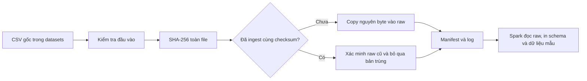

# So sánh thông tin dinh dưỡng đồ uống

**Beverage Nutrition Big Data** là đồ án môn Big Data, hướng tới xây dựng quy trình thu thập, xử lý và so sánh thông tin dinh dưỡng của các sản phẩm đồ uống từ dữ liệu công khai.

Nguồn dữ liệu hiện tại là **USDA FoodData Central — Branded Foods, bản phát hành tháng 04/2026**. Dự án sử dụng Python và PySpark chạy local trên Windows.

> **Trạng thái hiện tại: Checkpoint 2 — Môi trường, ingestion và lưu trữ raw.** Đã chạy kiểm chứng trên dữ liệu thật. Phần nhận diện đồ uống, nối bảng và phân tích dinh dưỡng thuộc giai đoạn tiếp theo.

## Bài toán và mục tiêu

Thông tin về sản phẩm, nhãn hàng, chất dinh dưỡng và đơn vị đo nằm ở nhiều bảng khác nhau. Để so sánh các đồ uống, cần xác định đúng nhóm sản phẩm, kết nối dữ liệu và đưa các chỉ số về cơ sở so sánh phù hợp.

Dự án hướng tới các công việc:

- Xây dựng quy trình tiếp nhận dữ liệu có thể chạy lại, giữ được nguồn gốc và phiên bản dữ liệu.
- Xác định sản phẩm đồ uống trong bộ dữ liệu thực phẩm có thương hiệu.
- Kết nối thông tin sản phẩm với các chất dinh dưỡng như năng lượng, đường, protein, chất béo và natri.
- Phân tích sự khác biệt giữa các nhóm đồ uống hoặc nhãn hàng sau khi xử lý đơn vị và dữ liệu thiếu.

Các chỉ số, tiêu chí phân nhóm và hình thức trình bày kết quả sẽ được chốt ở giai đoạn phân tích. Repository hiện chưa có kết quả so sánh dinh dưỡng cuối cùng.

## Phạm vi đã triển khai

| Hạng mục | Trạng thái |
| --- | --- |
| Môi trường Python 3.11, Java 17, PySpark 3.5.9 | Đã thiết lập và kiểm tra Spark local |
| Ingestion bốn bảng CSV theo batch | Đã triển khai |
| Lưu raw nguyên byte, kiểm tra SHA-256 | Đã triển khai |
| Phát hiện dữ liệu trùng khi chạy lại | Đã triển khai |
| Manifest, log và bằng chứng kiểm chứng | Đã triển khai |
| Đọc schema và dữ liệu mẫu bằng Spark | Đã triển khai |
| Lọc đồ uống, nối bảng, chuẩn hoá dinh dưỡng | Chưa triển khai |
| Phân tích, biểu đồ hoặc dashboard | Chưa triển khai |

Ingestion hiện dùng Python để kiểm tra và sao chép file local; Spark được dùng cho kiểm tra môi trường và đọc raw. Dự án chạy trên một máy với `local[*]`, chưa triển khai cluster.

## Dữ liệu

- **Nguồn:** [USDA FoodData Central](https://fdc.nal.usda.gov/).
- **Tải dữ liệu:** [Download Datasets](https://fdc.nal.usda.gov/download-datasets/), chọn **Branded — April 2026 — CSV**.
- **Tài liệu:** [FoodData Central Data Type Documentation](https://fdc.nal.usda.gov/data-documentation/).
- **Phiên bản dự án sử dụng:** 04/2026; các archive đã kiểm kê có nhãn ngày `2026-04-30`.
- **Metadata nguồn:** [metadata/source_usda.json](metadata/source_usda.json).

Bốn bảng được nạp vào raw:

| File | Nội dung | Vai trò ở bước phân tích tiếp theo |
| --- | --- | --- |
| `food.csv` | Mã và mô tả thực phẩm | Xác định sản phẩm và hỗ trợ lọc đồ uống |
| `branded_food.csv` | Nhãn hàng, thành phần, khẩu phần, nhóm sản phẩm | Bổ sung thông tin thương mại và phân nhóm |
| `food_nutrient.csv` | Giá trị chất dinh dưỡng theo sản phẩm | Lấy các chỉ số cần so sánh |
| `nutrient.csv` | Tên và đơn vị của chất dinh dưỡng | Diễn giải các giá trị dinh dưỡng |

Ở bước nối bảng dự kiến, `fdc_id` liên kết sản phẩm giữa ba bảng đầu; `food_nutrient.nutrient_id` liên kết với `nutrient.id`. Cần giữ nguyên ý nghĩa dữ liệu thiếu và kiểm tra cơ sở đo trước khi so sánh; không tự quy đổi dữ liệu trên 100 g thành trên 100 ml.

**Dataset và raw không được đưa lên GitHub.** Người chạy cần chuẩn bị CSV riêng. Bản ZIP JSON đã được kiểm kê trong lần triển khai gốc, chưa được giải nén hoặc ingest; JSON không cần cho luồng chạy mặc định. Open Food Facts mới là nguồn dự phòng dự kiến.

## Công nghệ

| Thành phần | Cấu hình dự án |
| --- | --- |
| Hệ điều hành chạy hiện tại | Windows x64, PowerShell |
| Python | 3.11; bản đã kiểm chứng: 3.11.17 |
| Java | Eclipse Temurin 17; bản đã kiểm chứng: 17.0.20.1 |
| PySpark / Spark | 3.5.9 |
| Py4J | 0.10.9.7 |
| Chế độ Spark | `local[*]` |
| Môi trường và runtime | `.venv/` và `.tools/` trong dự án |

Thư viện được ghim trong [requirements.txt](requirements.txt). Các script sử dụng runtime của dự án và thiết lập biến môi trường trong tiến trình chạy, không thay đổi `PATH` hoặc `JAVA_HOME` toàn máy. Cấu hình hiện tại chạy trực tiếp trên Windows, không yêu cầu Docker, HDFS hoặc Kafka.

## Cấu trúc repository

```text
beverage-nutrition-bigdata/
├── README.md
├── requirements.txt
├── setup.ps1                    # Thiết lập môi trường
├── RUN_CHECKPOINT2.ps1          # Chạy demo Checkpoint 2
├── config/
│   └── project.json            # Đường dẫn, danh sách CSV và schema
├── src/
│   ├── checkpoint2.py          # Điều phối demo, tóm tắt terminal và lưu log
│   ├── common.py               # Hàm dùng chung: cấu hình, hash, log, Spark
│   ├── env_check.py            # Kiểm tra môi trường và Python worker
│   ├── ingest_file.py          # Kiểm tra CSV, copy vào raw, chống trùng
│   ├── inspect_raw.py          # Đọc raw bằng Spark và hiển thị mẫu
│   └── main.py                 # Lối gọi kiểm tra môi trường tương thích cũ
├── scripts/                    # Bootstrap runtime, kiểm chứng và tạo báo cáo
├── tests/                      # Kiểm thử ingestion với dữ liệu nhỏ
├── datasets/usda_branded_2026/  # Dataset gốc, Git bỏ qua
│   ├── csv/
│   └── json/
├── data/raw/                   # CSV sau ingestion, Git bỏ qua
├── metadata/
│   ├── source_usda.json        # Nguồn và phiên bản dữ liệu
│   ├── dataset_layout_manifest.json
│   └── manifests/ingestion.jsonl
├── docs/
│   ├── architecture.md
│   ├── checkpoint2_report.md
│   ├── PITCH_4_MINUTES.md
│   ├── NEXT_STEPS.md
│   └── evidence/               # Bằng chứng của các lần kiểm chứng
├── logs/checkpoint2/           # Log chạy, Git bỏ qua
├── .tools/                     # Runtime cục bộ, Git bỏ qua
└── .venv/                      # Môi trường Python, Git bỏ qua
```

## Cài đặt và chạy

Sau khi clone hoặc tải repository, mở **PowerShell tại thư mục gốc**, nơi chứa `README.md` và `setup.ps1`. Các lệnh bên dưới đều chạy tại đây.

### 1. Chuẩn bị dữ liệu

Tải và giải nén bộ CSV đúng phiên bản, sau đó đặt các CSV trực tiếp trong thư mục sau, tránh lồng thêm một cấp thư mục:

```text
datasets/usda_branded_2026/csv/
├── branded_food.csv
├── food.csv
├── food_nutrient.csv
└── nutrient.csv
```

Bốn file trên đủ cho luồng ingestion mặc định. Có thể giữ các CSV khác và ZIP gốc tại vị trí đã kiểm kê; chương trình chỉ ingest các file trong `default_files` của [config/project.json](config/project.json).

### 2. Thiết lập môi trường một lần

Cần có Python 3.11 trở lên để chạy script bootstrap và kết nối mạng để tải runtime, thư viện. Nếu máy có Python Launcher (`py`), chạy:

```powershell
.\setup.ps1
```

Nếu dùng một interpreter có sẵn thay cho `py`, chỉ định đường dẫn thực tế:

```powershell
.\setup.ps1 -BootstrapPython 'C:\duong-dan\python.exe'
```

Script tải Python 3.11 và JDK 17 vào `.tools/`, đối chiếu SHA-256, tạo `.venv/`, cài thư viện và chạy `pip check`. Thông tin gói runtime được lưu trong [runtime_downloads.json](docs/evidence/runtime_downloads.json).

Cần dung lượng cho dataset gốc, runtime, thư viện và bản sao raw. Bốn CSV raw của lần kiểm chứng gốc chiếm khoảng **2,83 GB**.

### 3. Cấu hình manifest cho bản clone mới

Repository lưu [manifest lịch sử](metadata/manifests/ingestion.jsonl) làm bằng chứng, trong khi raw không được đưa lên GitHub. Vì vậy, **trên bản clone mới chưa có raw**, mở `config/project.json` và chỉ đổi trường `manifest` từ `metadata/manifests/ingestion.jsonl` sang `logs/checkpoint2/ingestion.local.jsonl`.

Giữ nguyên các trường còn lại. Chương trình sẽ tạo manifest riêng khi ingest; manifest lịch sử vẫn được giữ để đối chiếu. Đây là cấu hình local của bản clone, không cần commit thay đổi này. Nếu mất thư mục `logs/` chứa manifest local, cần khôi phục manifest cùng raw trước khi chạy tiếp.

**Trên máy đã có raw và manifest tương ứng, giữ nguyên cấu hình hiện tại.** Nếu raw đã nạp bị thiếu hoặc hỏng, cần kiểm tra log và dữ liệu thay vì đổi manifest để bỏ qua lỗi.

### 4. Chạy trọn Checkpoint 2

Sau khi hoàn tất các bước chuẩn bị:

```powershell
.\RUN_CHECKPOINT2.ps1
```

Script gọi các bước theo thứ tự:

1. Kiểm tra môi trường: Spark đếm 1.000.000 dòng tự tạo và thử Python worker.
2. Ingest bốn CSV **ba lần** để kiểm tra hành vi chạy lại.
3. Đọc schema và năm dòng raw của `branded_food.csv` để kiểm tra.

Terminal hiển thị ngắn gọn trạng thái từng bước, thời gian chạy, phiên bản môi trường, số file mới/trùng và kết quả kiểm tra raw. Cảnh báo Spark, JSON, schema và bảng mẫu đầy đủ được lưu tại thư mục log riêng cho mỗi lần chạy: `logs/checkpoint2/run_<ma-lan-chay>/`. Nếu có lỗi, chương trình dừng, hiện lý do ngắn gọn và trả mã thoát khác `0`.

Khi nguồn chưa được ingest, lần đầu có trạng thái `INGESTED`; hai lần sau có `SKIPPED_DUPLICATE`. Nếu nguồn đã có raw hợp lệ từ trước, cả ba lần đều có thể là `SKIPPED_DUPLICATE`.

### 5. Chạy từng bước khi cần

Thay cho script tổng, có thể chạy riêng từng module:

```powershell
# Kiểm tra Python, Java, Spark và Python worker
.\.venv\Scripts\python.exe -m src.env_check

# Ingest bốn CSV mặc định
.\.venv\Scripts\python.exe -m src.ingest_file

# Xem schema và năm dòng raw
.\.venv\Scripts\python.exe -m src.inspect_raw
```

Một số tuỳ chọn:

```powershell
# Chỉ ingest một bảng
.\.venv\Scripts\python.exe -m src.ingest_file --source datasets/usda_branded_2026/csv/branded_food.csv

# Xem mười dòng của bảng food đã ingest
.\.venv\Scripts\python.exe -m src.inspect_raw --file food.csv --rows 10
```

Các lệnh gọi thẳng Python trong `.venv`, không cần kích hoạt môi trường trước. File `.ps1` điều phối các bước bằng PowerShell; các module đầu vào chạy bằng `python -m`. `src/common.py` được import tự động. `src/main.py` hiện chỉ gọi kiểm tra môi trường, chưa điều phối toàn bộ bài toán phân tích.

## Luồng xử lý và đầu ra



Raw được lưu theo dataset, ngày UTC và mã lần chạy:

```text
data/raw/usda_branded_2026_04/
└── ingest_date=YYYY-MM-DD/
    └── run_id=<ma-lan-chay>/
        ├── branded_food.csv
        ├── food.csv
        ├── food_nutrient.csv
        └── nutrient.csv
```

| Đầu ra | Vị trí |
| --- | --- |
| CSV raw | `data/raw/` |
| Nhật ký ingest, skip, lỗi và checksum | Đường dẫn `manifest` trong `config/project.json` |
| Log và tóm tắt từng lần ingest | `logs/checkpoint2/` |
| Kết quả kiểm tra môi trường | `docs/evidence/environment.json` |
| Schema và dữ liệu mẫu | `docs/evidence/raw_inspection.json` |

CSV nguồn được giữ nguyên. Chương trình kiểm tra toàn bộ checksum nguồn/raw trước khi chấp nhận dữ liệu trùng, không tạo thêm bản sao khi skip. Nếu raw cũ bị thiếu hoặc sai checksum, batch báo lỗi. CLI ingestion trả mã thoát `0` khi thành công hoặc skip hợp lệ, `1` khi có lỗi.

## Kiểm thử và kết quả đã ghi nhận

Kiểm thử ingestion với fixture nhỏ và kiểm tra phụ thuộc:

```powershell
.\.venv\Scripts\python.exe -m unittest discover -s tests -v
.\.venv\Scripts\python.exe -m pip check
```

Bằng chứng của lần triển khai Checkpoint 2 ngày **23/10/2026**:

| Nội dung | Kết quả đã lưu |
| --- | --- |
| Spark smoke test | Đếm đúng 1.000.000 dòng và Python worker PASS |
| Unit tests | 13 PASS, không có failure hoặc error |
| Ingestion dữ liệu thật | Bốn CSV, tổng 2.825.968.318 byte |
| Kiểm tra chạy lại | Lần đầu 4 `INGESTED`, hai lần sau mỗi lần 4 `SKIPPED_DUPLICATE` |
| Bảo toàn nguồn | 12/12 tệp kiểm kê giữ nguyên hash, size và mtime |
| Spark inspect | Schema 21 cột và năm dòng mẫu của `branded_food.csv` |

Xem [báo cáo Checkpoint 2](docs/checkpoint2_report.md) và [validation.json](docs/evidence/validation.json) để đối chiếu. Đây là kết quả của các lần chạy được lưu trong repository, không tự xác nhận môi trường của người clone. Chưa thử cài sạch toàn bộ trên máy thứ hai.

Công cụ kiểm chứng đầy đủ của lần triển khai gốc:

```powershell
.\.venv\Scripts\python.exe -m scripts.validate_checkpoint
```

Lệnh này chạy smoke test, tests, ba lần ingestion, inspect và kiểm tra bảo toàn nguồn; đồng thời cập nhật evidence tổng hợp. Nó đối chiếu với `inventory_before.json` của bộ dữ liệu gốc, gồm cả các file ngoài bốn CSV mặc định. Vì vậy, bản clone chỉ có bốn CSV hoặc khác mtime có thể không đạt phần bảo toàn nguồn dù ingestion hoạt động. Dùng unit tests và script demo để kiểm tra luồng chạy trên bản clone; giữ baseline gốc để đối chiếu lịch sử.

Chạy lại các module sẽ cập nhật evidence tương ứng và bổ sung log/manifest. Chỉ cập nhật báo cáo khi đã đối chiếu các kết quả mới.

## Giới hạn hiện tại

- Bộ CSV vẫn chứa toàn bộ thực phẩm trong release, chưa phải tập dữ liệu đồ uống đã lọc.
- Kiểm tra đầu vào gồm file tồn tại, khác rỗng, đuôi CSV, header, độ rộng và kiểu số trong tối đa **1.000 bản ghi đầu**. SHA-256 bao phủ toàn file, nhưng không xác nhận chất lượng ngữ nghĩa của mọi bản ghi.
- Spark inspect mới đọc schema và dữ liệu mẫu; chưa đếm hoặc kiểm tra toàn bộ raw.
- Chưa đánh giá hiệu năng xử lý phân tán, chưa nối bảng và chuẩn hoá dinh dưỡng.
- URL tải gốc và thời điểm tải của các archive local chưa được ghi nhận; thời gian ingest không được dùng thay cho ngày tải.

## Xử lý một số lỗi thường gặp

| Hiện tượng | Cách kiểm tra |
| --- | --- |
| PowerShell chặn `.ps1` | Dùng lệnh bên dưới để chạy với policy chỉ áp dụng cho tiến trình đó |
| Không có `.venv/Scripts/python.exe` | Chạy `setup.ps1` tại thư mục gốc |
| Không tìm thấy CSV | Kiểm tra các file nằm trực tiếp trong `datasets/usda_branded_2026/csv/` |
| Không tìm thấy Java | Kiểm tra `.tools/runtime.json` và file `bin/java.exe` tại `java_home` được ghi trong đó |
| `Prior raw copy is missing or corrupt` | Với bản clone mới, làm bước cấu hình manifest local; với máy đã chạy, kiểm tra bản raw và log |
| Có `ingestion.lock` sau khi bị ngắt | Xác nhận tiến trình ghi đã dừng và kiểm tra log/raw trước khi xử lý file lock |

```powershell
# Thiết lập môi trường nếu PowerShell chặn script
powershell -NoProfile -ExecutionPolicy Bypass -File .\setup.ps1

# Chạy demo nếu PowerShell chặn script
powershell -NoProfile -ExecutionPolicy Bypass -File .\RUN_CHECKPOINT2.ps1
```

Cảnh báo native Hadoop/winutils đã xuất hiện trong các lần chạy PASS trên Windows. Đối chiếu mã thoát, log và trường `status` trong evidence để xác định kết quả thực tế. Chi tiết xử lý raw và hành vi sau khi bị ngắt nằm trong [tài liệu kiến trúc](docs/architecture.md).

## Hướng phát triển

- Chốt tiêu chí nhận diện và phân nhóm đồ uống.
- Nối thông tin sản phẩm, nhãn hàng và chất dinh dưỡng.
- Kiểm tra dữ liệu thiếu, đơn vị đo và cơ sở so sánh dinh dưỡng.
- Xây dựng các thống kê, biểu đồ hoặc giao diện phù hợp với câu hỏi phân tích.

Xem [NEXT_STEPS.md](docs/NEXT_STEPS.md) cho các công việc tiếp theo.

## Tài liệu và dữ liệu trên GitHub

| Tài liệu | Nội dung |
| --- | --- |
| [Kiến trúc](docs/architecture.md) | Luồng gọi, lưu raw, manifest và hành vi chạy lại |
| [Báo cáo Checkpoint 2](docs/checkpoint2_report.md) | Kết quả, giới hạn kiểm chứng và đối chiếu yêu cầu môn học |
| [Kịch bản trình bày](docs/PITCH_4_MINUTES.md) | Nội dung giải thích dự án trong bốn phút |
| [Evidence](docs/evidence/) | Kết quả kiểm chứng đã lưu |
| [Metadata nguồn](metadata/source_usda.json) | Phiên bản, nguồn dữ liệu và thông tin chưa xác nhận |

Repository lưu mã nguồn, cấu hình, tài liệu và bằng chứng nhỏ. [`.gitignore`](.gitignore) loại dataset, raw, ZIP, runtime, môi trường ảo, log và `.env` khỏi các file mới đưa vào Git. Các evidence/manifest lịch sử được giữ để review; khi cập nhật cần kiểm tra diff trước khi commit.

Dữ liệu FoodData Central được USDA công bố theo **CC0 1.0**, xem [điều khoản tại nguồn](https://fdc.nal.usda.gov/). Nguồn dữ liệu sử dụng trong đồ án: U.S. Department of Agriculture, Agricultural Research Service, FoodData Central, Branded Foods, April 2026 release.
