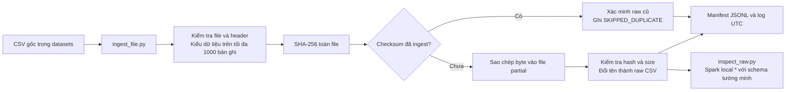

# Kiến trúc Checkpoint 2

Đề tài cuối cùng là so sánh thông tin dinh dưỡng đồ uống. Checkpoint này thiết lập môi trường, đưa bốn CSV USDA vào raw và chứng minh khả năng chạy lại. Toàn bộ thực phẩm trong CSV được giữ nguyên; tiêu chí đồ uống sẽ được xây dựng ở checkpoint sau.



## Thành phần và luồng gọi

| Tệp hoặc thư mục | Vai trò |
| --- | --- |
| `setup.ps1` | Chạy một lần để tải runtime riêng và cài `.venv` |
| `scripts/bootstrap_runtime.py` | Lấy Python 3.11 từ Astral và JDK 17 từ Adoptium, đối chiếu SHA-256 |
| `.tools/` | Runtime và gói tải về, được Git bỏ qua |
| `.venv/` | PySpark và Py4J của dự án, được Git bỏ qua |
| `config/project.json` | Danh sách bốn CSV, schema, số dòng kiểm tra và đường dẫn |
| `src/common.py` | Đường dẫn, UTC, SHA-256, ghi JSON và tạo SparkSession |
| `src/checkpoint2.py` | Điều phối demo, hiện tóm tắt terminal, lưu stdout/stderr đầy đủ theo từng lần chạy |
| `src/env_check.py` | Phiên bản thực tế, `range(1_000_000).count()` và Python worker |
| `src/ingest_file.py` | Quality gate, copy nguyên byte, dedupe, manifest và log |
| `src/inspect_raw.py` | Đọc raw từ manifest bằng Spark, in schema và vài dòng |
| `src/main.py` | Lối gọi tương thích với lệnh kiểm tra cũ |
| `scripts/validate_checkpoint.py` | Chạy kiểm chứng và tổng hợp evidence |
| `tests/test_ingestion.py` | Fixture tạm kiểm tra lỗi, toàn vẹn, chạy lại và bảo vệ raw |
| `datasets/` | CSV và ZIP người dùng đã tải, chỉ đọc |
| `data/raw/` | Bản sao CSV đã kiểm tra, không ghi đè |
| `metadata/manifests/ingestion.jsonl` | Nhật ký mỗi lần ingest, skip hoặc lỗi; nhỏ nên có thể vào Git |
| `docs/evidence/` | Bằng chứng JSON nhỏ và bản ghi versions; có thể vào Git |
| `logs/checkpoint2/` | Log chi tiết, bản sao cấu hình trước sửa; nằm ngoài Git |

`RUN_CHECKPOINT2.ps1` gọi `src.checkpoint2`, lần lượt chạy môi trường một lần, ingestion ba lần rồi inspect. Terminal chỉ hiển thị tiến độ, kết quả và số liệu chính; stdout/stderr đầy đủ, schema và bảng mẫu được lưu trong `logs/checkpoint2/run_<ma-lan-chay>/`. Khi một bước lỗi, chương trình dừng và trả mã thoát khác 0. Khi chạy Python trực tiếp, chỉ gọi các module đầu vào cần thiết. Các module `common` được import tự động, không chạy lần lượt từng file trong `src`.

## Bố trí raw và hành vi chạy lại

```text
data/raw/usda_branded_2026_04/
  ingest_date=YYYY-MM-DD/
    run_id=<UTC_timestamp_and_unique_id>/
      branded_food.csv
      food.csv
      food_nutrient.csv
      nutrient.csv
```

`ingest_date` lấy ngày UTC tại lúc bắt đầu batch. Mỗi sự kiện có nguồn, release, đường dẫn nguồn, tên file, run ID, thời điểm bắt đầu/kết thúc UTC, kích thước, checksum, đích, quality gate và trạng thái. Khoá dedupe gồm `(source, release, dataset, file_name, sha256)`.

Manifest, evidence JSON và log ứng dụng có timestamp UTC. Dòng log do JVM Spark tự sinh trong console dùng múi giờ Windows của máy (Asia/Saigon trong lần chạy này); không diễn giải các dòng đó như UTC.

Một checksum mới tạo một bản raw trong run mới. Checksum đã tồn tại chỉ skip sau khi xác minh lại size và hash raw. Raw bị thiếu/hỏng tạo `FAILED` và exit code 1, không tự ghi đè. Chương trình dừng batch ở file lỗi đầu tiên, các file trước đó đã thành công vẫn được giữ; batch không có tính atomic toàn bộ bốn file.

File lock dùng exclusive create để chỉ cho một tiến trình ghi manifest. Mỗi bản raw đi qua file `.partial`, flush/fsync, xác minh checksum rồi rename. Nếu dừng bình thường khi lỗi, chương trình dọn đúng file partial nó vừa tạo. Nếu máy tắt cưỡng bức, lock/partial hoặc một bản raw chưa có manifest có thể còn lại. Cần kiểm tra PID, log và checksum trước khi xử lý phần dở dang; không xoá dataset nguồn hoặc tự sửa manifest để giấu lỗi. Retry dùng run ID mới; raw mồ côi được giữ để điều tra và không được tự xem là bản ingest thành công.

## Giới hạn kiểm tra

Gate kiểm tra tồn tại, dung lượng khác 0, đuôi CSV, header đúng thứ tự, độ rộng record và kiểu số khai báo trong tối đa 1000 record đầu. Chuỗi UPC giữ nguyên kiểu string để giữ số 0 đầu. Null cho trường tuỳ chọn được phép. Đây là gate đầu vào, chưa bảo đảm chất lượng ngữ nghĩa hoặc mọi record trong file. Hash được tính trên toàn file nguồn và toàn bản sao; inspect dùng schema tường minh và đọc vài dòng, chưa kiểm đếm toàn bộ raw.

Spark chạy một JVM trên Windows với `local[*]`, dùng các CPU logic tại máy. CSV nhiều dòng được đọc với `multiLine=true`, `quote` và `escape` là dấu nháy kép. Điều này hỗ trợ nội dung quoted của USDA nhưng hạn chế chia partition một file lớn; chưa đo throughput hoặc tuyên bố năng lực cluster. Không cần dịch vụ Docker, HDFS hoặc Kafka.

## Căn cứ kỹ thuật

- [Apache PySpark 3.5.9 installation](https://spark.apache.org/docs/3.5.9/api/python/getting_started/install.html): hỗ trợ Python 3.8+ và Java 8/11/17; dự án chốt Python 3.11/Java 17 và xác nhận bằng smoke test.
- [USDA download datasets](https://fdc.nal.usda.gov/download-datasets/): Branded release 04/2026 có CSV và JSON.
- [Astral Python standalone](https://github.com/astral-sh/python-build-standalone): bản runtime độc lập.
- [Adoptium API](https://github.com/adoptium/api.adoptium.net/blob/main/docs/cookbook.adoc): metadata gói JDK 17.

Ngày kiểm tra các nguồn web: 23/10/2026. Đã đọc hai tài liệu môn học tại `G:\Downloads\Documents`: slide 8 xác nhận phương án A, slide 10 quy định smoke test một triệu dòng, slide 17 cho phép gate sơ bộ, slide 24 chấp nhận sample record và schema, slide 31 yêu cầu commit/tag. Xem report cho đối chiếu rubric.
